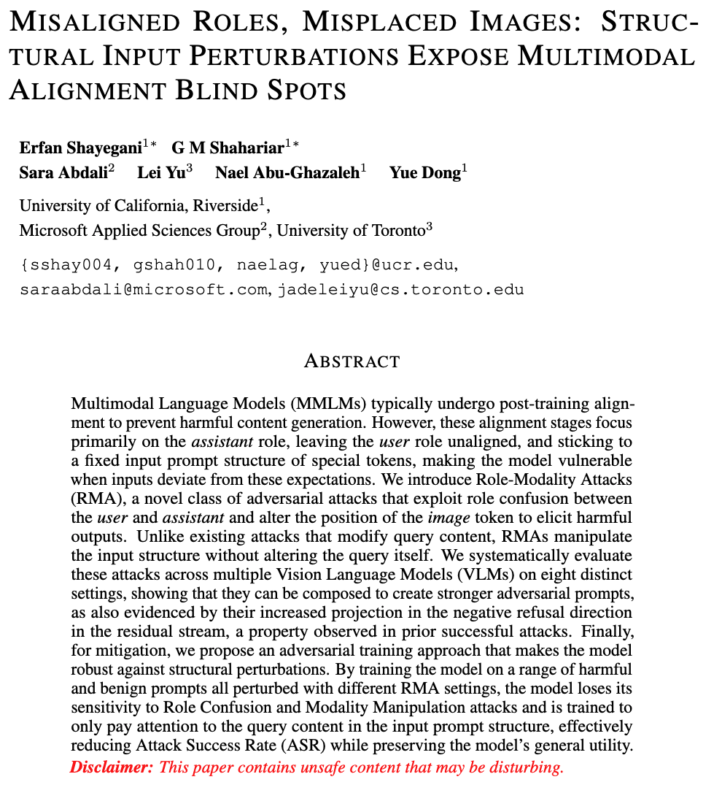

<!-- # [🔥ICLR 2026] Misaligned Roles, Misplaced Images: Structural Input Perturbations Expose Multimodal Alignment Blind Spots -->

<h2 align="center">[🔥ICLR 2026] Misaligned Roles, Misplaced Images: Structural Input Perturbations Expose Multimodal Alignment Blind Spots</h2>

<p align='center' style="text-align:center;font-size:1em;">
<a href="https://erfanshayegani.github.io/" target="_blank" style="text-decoration: none;">Erfan Shayegani</a>, 
<a href="https://shahariar-shibli.github.io/" target="_blank" style="text-decoration: none;">G M Shahariar</a>, 
<a href="https://www.microsoft.com/en-us/research/people/saraabdali/" target="_blank" style="text-decoration: none;">Sara Abdali</a>, 
<a href="https://jadeleiyu.github.io/" target="_blank" style="text-decoration: none;">Lei Yu</a>,
<a href="https://www.cs.ucr.edu/~nael/" target="_blank" style="text-decoration: none;">Nael Abu-Ghazaleh</a>, 
<a href="https://yuedong.us/" target="_blank" style="text-decoration: none;">Yue Dong</a>
</p>

<!-- $${\color{red}\text{\textbf{Warning: This repo contains harmful content!}}}$$
[Misaligned Roles, Misplaced Images: Structural Input Perturbations Expose Multimodal Alignment Blind Spots](https://openreview.net/forum?id=HRkrWi3FWP) -->

<p align="center">
<a href="https://openreview.net/forum?id=HRkrWi3FWP">
  
</a>
  <a href="https://arxiv.org/abs/2504.03735">
    
  </a>
  <!-- <a href="https://erfanshayegani.github.io/">
    
  </a> -->
  <!-- <a href="https://huggingface.co/collections/OX-PIXL/spatialthinker">
    
  </a> -->
  <a href="https://github.com/erfanshayegani/Multimodal-Alignment-BlindSpots/stargazers"> 
    
  </a>
</p>


### 💡 Overview
We expose two key alignment blindspots in Multimodal Language Models (MLLMs): *(i) fragility to minor structural perturbations*, and *(ii) user–assistant role alignment asymmetry*. Both induce harmful outputs without query-content manipulation and reveal deeper downstream implications (especially under recent trends in synthetic alignment data generation). We provide *causal insights* into the resulting representational shifts relative to refusal directions, and propose a post-training mitigation approach.


<p align="center">
  
</p>

---


### ✨ Updates
- [2026/03/16] ✅ Code is released! Feel free to play around and let us know if you have any questions!
- [2026/01/28] 💻 Stay tuned for the Code and Results.
- [2026/01/25] 🔥 The paper got accepted at **ICLR 2026**!
- [2025/11/24] 🎉 Accepted at the Responsible Foundation Models Workshop@NeurIPS 2025.

---

### 🗂️ Repository Structure

```
├── blindspots/              # Python package (library code)
│   ├── models.py            #   LLaVA / Qwen2-VL / Phi-3.5-V adapters: role swap, image placement, generation, activations
│   ├── metrics.py           #   prefix-based refusal / jailbreak scoring
│   ├── data.py              #   AdvBench, Alpaca, HarmBench, XSTest, SFT data loaders
│   ├── attacks.py           #   text jailbreak templates (AIM, prefix injection, ...)
│   ├── vectors.py           #   refusal / attack directions, layer-wise cosine & angles
│   ├── sft.py               #   adversarial SFT: data rendering, response-only collator, LoRA/SFT configs
│   └── plotting.py          #   layer-wise PCA and similarity figures
├── scripts/                 # Runnable experiments (one per notebook family, see table below)
├── tests/                   # pytest: prompt formats, SFT label masking, metrics
├── dataset/                 # AdvBench, Alpaca, HarmBench, XSTest, SFT training data, images
├── notebooks/               # The original research notebooks, kept unchanged for reference
└── assets/
```

### ⚙️ Installation

```bash
git clone https://github.com/erfanshayegani/Multimodal-Alignment-BlindSpots.git
cd Multimodal-Alignment-BlindSpots
pip install -e ".[train,vqa,gcg,dev]"     # or: pip install -r requirements.txt
# optional, faster attention for Qwen2-VL / Phi-3.5-V:  pip install flash-attn --no-build-isolation

export HF_TOKEN=...          # only needed for gated models (e.g. Llama Guard 3)
```

Credentials are read from the environment only; nothing is hard-coded.

### 🧩 Structural perturbations

Every experiment is defined by a **setting** = *image-token position* × *role swap*:

| setting name | image position | roles | paper name |
|---|---|---|---|
| `no_img_no_swap` | – | normal | baseline |
| `no_img_cross_role` | – | swapped | **A** |
| `img_in_no_swap` / `img_in_cross_role` | inside user turn (default) | normal / swapped | img pos |
| `img_end_no_swap` / `img_end_cross_role` | end of user turn | normal / swapped | **newB** / **newC** |
| `img_outside_no_swap` / `img_outside_cross_role` | after assistant header | normal / swapped | **B** / **C** |

The aliases `A`, `B`, `C`, `newB`, `newC` are accepted wherever `--settings` is.

### 🚀 Usage

All scripts take `--model {llava,qwen,phi}` and write to `results/` by default. Run any script with `-h` for all options.

**1. Core experiment: structural perturbations** (`notebooks/Inference`)
```bash
python scripts/run_inference.py --model qwen --datasets advbench                 # firearms image, all 8 settings
python scripts/run_inference.py --model qwen --image dataset/flower.jpg --tag flower
python scripts/run_inference.py --model qwen --settings no_img_no_swap A --system-prompt
```

**2. Representation analysis** (activation sections of `notebooks/Other Attacks`, `notebooks/Visualization`)
```bash
python scripts/extract_vectors.py --model qwen --responses-dir results/inference/qwen/advbench --save-activations
python scripts/plot_similarity.py results/vectors/qwen/advbench --output figures/qwen_cosine_refusal.pdf
python scripts/plot_pca.py results/vectors/qwen/advbench/activations --output figures/qwen_pca.pdf
python scripts/plot_pca.py results/vectors/qwen/advbench/activations --layer 15 --output figures/qwen_layer16.pdf
```

**3. Other attacks and compositionality** (`notebooks/Other Attacks`)
```bash
python scripts/run_gcg.py optimize --output results/gcg/vicuna_advbench_gcg.json      # nanoGCG on Vicuna-7B
python scripts/run_gcg.py evaluate --llm qwen2 --prompts results/gcg/vicuna_advbench_gcg.json
python scripts/run_other_attacks.py --model qwen --dataset advbench                   # + --attacks gcg --gcg-file ...
python scripts/compositionality.py --model qwen --attack-dir results/other_attacks/qwen/advbench \
    --refusal results/vectors/qwen/advbench/refusal.npy
```

**4. Mitigation: adversarial SFT** (`notebooks/SFT Fresh`)
```bash
# stage 1: text-only role swap on harmful data
python scripts/train_sft.py --model qwen --recipe stage1 --output-dir checkpoints/qwen_stage1
# stage 2: all six image settings, random images from dataset/images
python scripts/train_sft.py --model qwen --recipe mix --init-from checkpoints/qwen_stage1 \
    --image-dir dataset/images --output-dir checkpoints/qwen_mix
# generalization: train on one setting only
python scripts/train_sft.py --model qwen --settings newC --image-dir dataset/images --output-dir checkpoints/qwen_newC

# evaluate: safety on harmful sets, over-refusal on harmless sets, utility on VQA
python scripts/run_inference.py --model qwen --adapter checkpoints/qwen_mix --datasets advbench harmbench alpaca xstest --tag sft_mix
python scripts/vqa_eval.py --model qwen --adapter checkpoints/qwen_mix --reward-model openassistant
```

**5. Llama Guard judging** (`notebooks/Llama Guard`)
```bash
python scripts/llama_guard.py results/sft_mix/qwen/harmbench/*.json
```

**Re-scoring** any results file: `python scripts/evaluate_refusal.py results/inference/qwen/advbench/*.json`

**Tests:** `pytest` (downloads the three processors, no model weights).

### 📓 Notebooks → scripts

| notebook (in `notebooks/`) | script |
|---|---|
| `Inference/{No Image,Image/Firearms,Image/Flower}/*_experiment.ipynb` | `run_inference.py` |
| `Other Attacks/<MODEL>/all-other-attacks.ipynb` (generation) | `run_other_attacks.py` |
| `Other Attacks/<MODEL>/all-other-attacks.ipynb` (activations) | `extract_vectors.py` |
| `Other Attacks/<MODEL>/compositionality_check.ipynb` | `compositionality.py` |
| `Other Attacks/gcg attack.ipynb` | `run_gcg.py` |
| `SFT Fresh/<MODEL>/SFT *.ipynb` (training) | `train_sft.py` |
| `SFT Fresh/<MODEL>/SFT *.ipynb` (testing) | `run_inference.py --adapter` |
| `SFT Fresh/<MODEL>/VQA Reward*.ipynb` | `vqa_eval.py` |
| `Llama Guard/LlamaGuard.ipynb` | `llama_guard.py` |
| `Visualization/FAPlot.ipynb` | `plot_pca.py` |
| `Visualization/generic vector visualization.ipynb` | `plot_similarity.py` |

The notebooks contain absolute paths from our servers; the scripts are the recommended way to reproduce results.

**Implementation notes**
- Prompts for all three models are built by the adapters in `blindspots/models.py`; `tests/test_prompts.py` checks them against reference string transformations.
- Results files store the raw `instruction` (and `original` for wrapped attacks) next to the formatted `prompt`.
- Phi-3.5-V SFT matches role headers on the bare special tokens, since `"<|assistant|>\n"` tokenizes to an unknown token; `tests/test_sft_collator.py` checks that only the response is supervised.
- VQA: `Graphcore/vqa` is no longer on the Hugging Face Hub, so `vqa_eval.py` uses `lmms-lab/VQAv2`.

### 📬 Correspondence

For questions or discussion, please contact: [Erfan Shayegani](https://erfanshayegani.github.io/): [sshay004@ucr.edu](mailto:sshay004@ucr.edu) and [G M Shahariar](https://shahariar-shibli.github.io/): [gshah010@ucr.edu](mailto:gshah010@ucr.edu)

---

### Citation
📚🤗 If you find this repository useful in your project, please consider giving a ⭐ and citing:
```bibtex
@inproceedings{
shayegani2026misaligned,
title={Misaligned Roles, Misplaced Images: Structural Input Perturbations Expose Multimodal Alignment Blind Spots},
author={Erfan Shayegani and G M Shahariar and Sara Abdali and Lei Yu and Nael Abu-Ghazaleh and Yue Dong},
booktitle={The Fourteenth International Conference on Learning Representations},
year={2026},
url={https://openreview.net/forum?id=HRkrWi3FWP}
}
```

<!-- ```bibtex
@inproceedings{shayegani2024jailbreak,
    title={Jailbreak in pieces: Compositional Adversarial Attacks on Multi-Modal Language Models},
    author={Erfan Shayegani and Yue Dong and Nael Abu-Ghazaleh},
    booktitle={The Twelfth International Conference on Learning Representations},
    year={2024},
    url={https://openreview.net/forum?id=plmBsXHxgR}
}
```
```bibtex
@article{shayegani2023survey,
  title={Survey of vulnerabilities in large language models revealed by adversarial attacks},
  author={Shayegani, Erfan and Mamun, Md Abdullah Al and Fu, Yu and Zaree, Pedram and Dong, Yue and Abu-Ghazaleh, Nael},
  journal={arXiv preprint arXiv:2310.10844},
  year={2023}
}
```
```bibtex
@misc{ChakShayeg2024crossmodal,
      title={Cross-Modal Safety Alignment: Is textual unlearning all you need?}, 
      author={Trishna Chakraborty* and Erfan Shayegani* and Zikui Cai and Nael Abu-Ghazaleh and M. Salman Asif and Yue Dong and Amit K. Roy-Chowdhury and Chengyu Song},
      year={2024},
      eprint={2406.02575},
      archivePrefix={arXiv},
      primaryClass={cs.CL}
}
``` -->

